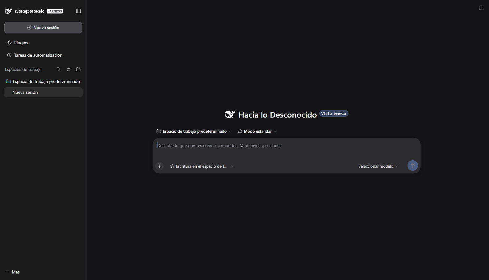
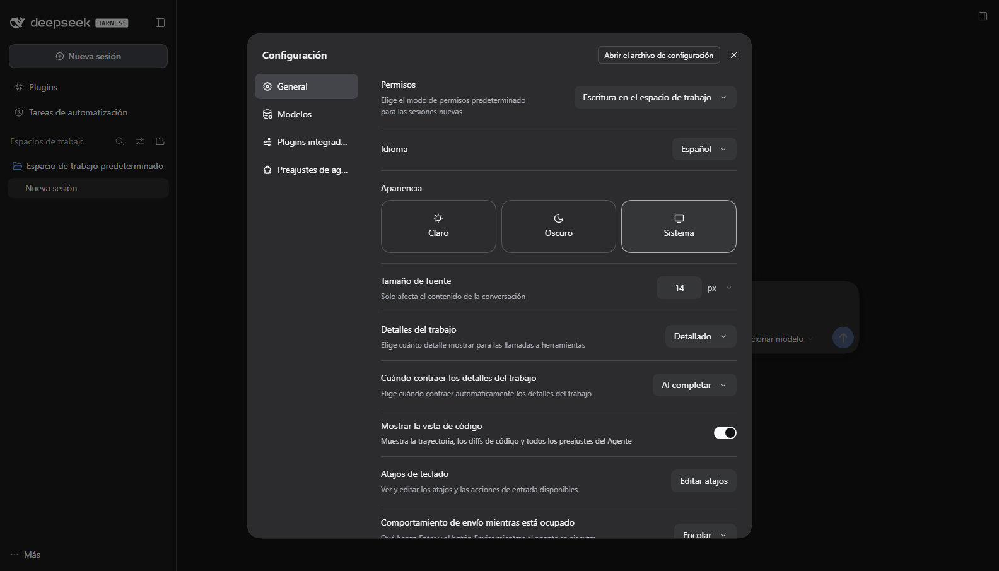
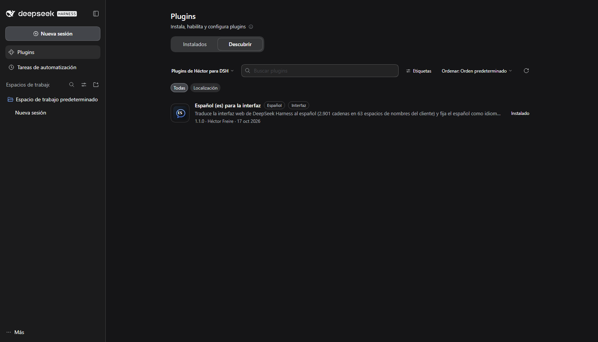

# dsh-locale-es — Español para DeepSeek Harness

Paquete de idioma (**language pack**) que traduce la interfaz web de
[DeepSeek Harness](https://github.com/deepseek-ai/deepseek-harness) al español
de Latinoamérica (neutro, con tuteo).

- **2.901 cadenas** en **63 espacios de nombres** del cliente: sesiones, chat,
  trayectoria, tarjetas de herramientas, Configuración completa (cuenta, modelos,
  apariencia, atajos, permisos), plugins y market, tareas de automatización,
  dictado por voz y traducción del razonamiento.
- Traduce además los rótulos del **menú de ventana de Windows**
  (*Aplicación* / *Edición*), que DSH dibuja fuera del sistema de locales web.
- Mantiene el inglés como respaldo: lo que no esté traducido se muestra en
  inglés, nunca en blanco.
- Fija **Español** como idioma de la interfaz. Podés cambiarlo en
  **Ajustes → General → Idioma**; tu elección gana sobre la del paquete.

## Capturas

Interfaz principal, con el aviso de versión preliminar ya traducido:



Ajustes → General: el selector de **Idioma** en «Español»:



El plugin publicado aparece en **Plugins → Descubrir**, listo para instalar:



Menú de ventana nativo de Windows en español:


## Instalar

### Desde el market (Discover)

1. Abrí **Plugins → Descubrir** y elegí **Gestionar fuentes del market…**.
2. Agregá esta fuente:

   ```
   https://raw.githubusercontent.com/hectoruy/dsh-locale-es/main/market/index.json
   ```

3. Buscá **Español** y pulsá **Instalar**. Después recargá la ventana (Ctrl+R).

### Instalación manual (Git)

En un perfil de DSH:

```bash
dsh plugin --profile <perfil> add git+https://github.com/hectoruy/dsh-locale-es.git
```

o, desde la página **Plugins**, instalá por URL de Git.

## Cómo funciona

El paquete es un *bundle* de DSH (`dsh.bundle.patch`): al activarse inserta su
fila de plugin de cliente (`locale-es`), registra el idioma `es` y los
diccionarios de cada espacio de nombres a través de `ctx.locale.register(ns, "es", …)`,
y fija `locale.preference: es`. El idioma se aplica en caliente.

Los rótulos del menú de ventana de Windows los dibuja el *preload* de DSH con su
propio diccionario (solo en/zh); el cliente del plugin corrige esos rótulos por
DOM cuando el idioma activo es español, así que también se aplican sin tocar la
aplicación instalada.

El bundle cuesta ~187 KB (diccionarios incluidos) y no tiene dependencias de
ejecución.

## Qué sigue en inglés

- Los elementos desplegables de los menús *Aplicación* / *Edición* son menús
  nativos que DSH construye en su proceso principal con textos propios: solo se
  pueden traducir modificando los archivos de la aplicación (no es algo que un
  plugin de perfil pueda hacer).
- Descripciones de los *bundles* integrados en Plugins → Instalados: vienen del
  `package.json` de cada paquete de DeepSeek (en/zh).
- Títulos/descripciones que el host envía ya formados en algunas tarjetas de
  herramientas, y el contenido generado por el modelo.

## Desinstalar

**Plugins → Instalados → Quitar** (o `dsh plugin --profile <perfil> remove dsh-locale-es`),
y recargá la ventana. El inglés vuelve a ser el idioma.

## Desarrollo

El proyecto de traducción (diccionarios fuente, generador del bundle y extractor
de cadenas desde DSH) vive en este mismo repositorio, en la carpeta `tools/` del
árbol superior cuando se trabaja desde el checkout local; el bundle publicado es
`lib/client.js`, generado desde `es-dicts.json`.

Reglas de traducción: marcadores `{name}` intactos, espacios de concatenación
preservados, sin traducir identificadores técnicos ni nombres de producto,
español neutro de interfaz.

## Licencia

MIT © Héctor Freire
